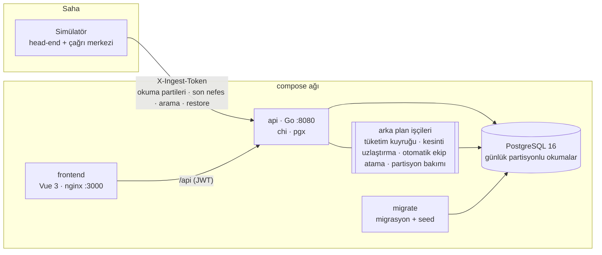

# EnerjiHat — Akıllı Sayaç, Tüketim Faturalama ve Kesinti Yönetimi

**Geliştiren:** Sena Sadık ([@senasd489](https://github.com/senasd489)) · DDO Yazılım Ekibi alım projesi

Bölgesel bir elektrik dağıtım şirketi için: 15 dakikalık akıllı sayaç okumalarından tüketim hesabı, kademeli/zaman dilimli tarifeyle fatura, şebeke topolojisi üzerinde kesinti etkisi ve SAIDI/SAIFI, son nefes + arama sinyallerinin kesinti olaylarına kümelenmesi ve ekip ataması, kayıp-kaçak analizi. Go + PostgreSQL 16 + Vue 3, tek komutla Docker Compose.

---

## Kurulum (tek komut)

```bash
git clone https://github.com/senasd489/ddo-case-sena-sadik.git && cd ddo-case-sena-sadik
cp .env.example .env
docker compose up --build
```

| Servis | Adres | Not |
|---|---|---|
| Arayüz (Vue + nginx) | http://localhost:3000 | `/api` isteklerini API'ye vekiller |
| API (Go) | http://localhost:8080 | `/health`, `/metrics`, `/openapi.yaml` |
| PostgreSQL 16 | yalnızca compose ağında | host'a açılmaz |
| Simülatör | — | 5000 sayaç; önce 48 saati hızla, sonra gerçek zamanlı akar; 3 dk'da bir arıza üretir |

Migrasyon + seed (`migrate` servisi) otomatik çalışır, `api` onun başarıyla bitmesini (`service_completed_successfully`), `api`/`frontend`/`simulator` ise sağlık kontrollerini (`service_healthy`) bekler. Tüm imajlar çok aşamalı ve root olmayan kullanıcıyla çalışır (Go: `distroless/static:nonroot`, frontend: `nginx-unprivileged`). Bağımlılıklar `vendor/` altında olduğundan Go derlemesi ağ istemez.

**Demo hesapları** (parola: `Demo1234!`): `abone@` · `abone2@` · `saha@` · `fatura@` · `operator@` · `analist@` · `admin@` — hepsi `…@enerjihat.local`. Ayrıntı: [TESTING.md](TESTING.md).

### Komutlar

| Komut | Ne yapar |
|---|---|
| `make verify` | Sistemi kaldırır ve **25 uçtan uca kontrolü** (F-1…F-7, T-1…T-5, health, auth, RBAC, yarış, idempotency, denetim, arayüz) çalıştırır; PASS/FAIL tablosu, hata varsa çıkış kodu ≠ 0 (~10 sn) |
| `make reset-demo` | Verileri ilk seed haline döndürür |
| `make load` | k6 yük testi (60 sn karışık trafik) |
| `make chaos` | DB'yi ve API'yi durdurup sistemin toparlandığını gösterir |
| `make bench-t1` | ≈10 milyon okuma ile T-1 ölçümü (ayrı bench veritabanında) |
| `make bench-t4` | Yerleştirilmiş kaçaklarla T-4 precision/recall (filtreli vs filtresiz) |
| `make explain` | Dizinli/dizinsiz `EXPLAIN ANALYZE` |
| `make test` / `make lint` | Go testleri (race) / vet + gofmt + vue-tsc |

---

## Mimari



```
backend/
  cmd/api           HTTP sunucusu + migrate | seed | reset | bench-t1 | bench-t4 | healthcheck
  cmd/simulator     veri üretici (deterministik, SIM_SEED)
  cmd/verify        make verify çalıştırıcısı
  internal/
    metering        T-1  okuma alma (COPY/ON CONFLICT), tüketim hesabı (pencere fonksiyonları), sayaç değişimi
    billing         T-2  saf tarife motoru (big.Rat) + fatura/ödeme servisi
    grid            T-3  topoloji (recursive CTE), anahtarlama, kesinti durum makinesi, SAIDI/SAIFI
    dispatch        T-5  sinyal kümeleme (LCA), ekip atama (SKIP LOCKED), restore
    loss            T-4  trafo dengesi, robust istatistikle şüpheli tespiti
    auth · idempotency · audit · httpx · metrics · customers · users · seed · demo · sim
    db/migrations   12 SQL migrasyonu (gömülü, advisory lock'lu migratör)
frontend/           Vue 3 + Vite + TypeScript + Pinia + Chart.js
scripts/            wait-healthy, chaos, explain.sql, load/k6.js, domain-coverage.py
docs/bench/         ölçüm çıktıları (t1, t4, load, explain)
```

**Temel kararlar** (ayrıntı ve alternatifler [DECISIONS.md](DECISIONS.md)'de, 12 kayıt):

* **Düz SQL + pgx, ORM yok** — işin ağırlığı PostgreSQL'e özgü SQL'de (recursive CTE, pencere fonksiyonları, `EXCLUDE`, `SKIP LOCKED`, `COPY`).
* **Okumalar günlük partisyonlu**; parti `COPY → geçici tablo → tek INSERT … ON CONFLICT` ile yazılır: aynı değer tekrar, farklı değer düzeltme sayılır.
* **Tüketim, kirli sayaç-gün kuyruğundan** tek set-tabanlı SQL ile hesaplanır; kuyruk üç kısa işlemle işlenir (talep → hesapla → sil).
* **Fatura motoru saf fonksiyon**; `big.Rat`, satır başına tek yuvarlama, girdi özeti ile deterministik yeniden üretim.
* **Her paylaşılan durum için en dar kilit**: ödeme `FOR UPDATE`, ekip ataması `SKIP LOCKED` + kısmi unique index, kümeleme/planlı kesinti advisory lock, döngü engeli tetikleyicide.
* **Kayıp-kaçak açıklanabilir**: log ölçekte medyan/MAD + kalite/bağlam/kalıcılık/çapraz kanıt filtreleri; her işaretin gerekçesi saklanır.
* **Frontend: Vue 3** — Composition API okunaklı, derleme hızlı; rol başına zengin ekranlar (grafik, ağaç, harita) için HTMX'ten uygun; React'e göre bu ölçekte fark yok, şablon sözdizimi ekip için daha tanıdık.

### Ortak teknik gereksinimler nerede?

| Gereksinim | Uygulama |
|---|---|
| Parola / oturum | argon2id (m=19 MiB, t=2, p=1); JWT access 15 dk + dönen refresh (yeniden kullanımda tüm aile iptal) |
| RBAC | Her route'ta `auth.Require(roller…)`; abone satır düzeyi `CanAccessSubscriber`; 401/403 sunucuda |
| Migrasyon & kısıtlar | 12 migrasyon; FK, UNIQUE, CHECK, kısmi unique index, `EXCLUDE USING gist` (tarife dönemi, planlı kesinti), bileşik FK (abone yalnızca direğe) |
| Para | tutarlar `bigint` kuruş, birim fiyat `numeric`; float yok |
| Eşzamanlılık | DECISIONS ADR-006 tablosu — her biri testle kanıtlı |
| Idempotency | `Idempotency-Key`: (kullanıcı, anahtar) başına ilk cevap saklanır; farklı gövde 422; işlemdeyse 409; ödemede zorunlu |
| Denetim | `audit_log` eklemeli-yalnız (UPDATE/DELETE/TRUNCATE tetikleyiciyle reddedilir), değişiklikle aynı işlemde yazılır |
| API | `{"error":{"code","message","details"}}`; sunucu tarafı doğrulama (422); keyset sayfalama; OpenAPI `GET /openapi.yaml` |
| Dayanıklılık | istek başına `context` zaman aşımı, düzgün kapanış, JSON log (gövde/başlık loglanmaz), tüm yapılandırma ortam değişkenlerinden |
| Gözlem | `/metrics` Prometheus (istek sayısı/süresi, okuma sonuçları, kuyruk, kesinti geçişleri, ekip atamaları, kayıp işaretleri) |

---

## Zorlu görevler — yaklaşım ve kanıt

### T-1 Okuma birleştirme ve tüketim farkları
* Okuma alma: `COPY` → geçici tablo → parti içi tekrar (son gelen kazanır) → sayacın kurulu olduğu aralık kontrolü → `INSERT … ON CONFLICT DO UPDATE … WHERE değer farklı` (düzeltmenin eski değeri `reading_corrections`'a).
* Hesap: bilinen noktalar (gün içi + öncesi/sonrası en yakın okuma + sayaç takma/sökme sentetik noktaları) → `LAG()` → segment → k slota tam sayı bölme; `interpolated` / `reset` / `meter_change` / `corrected` işaretleri fatura dökümüne kadar taşınır.
* **Ölçüm** (`docs/bench/t1.txt`, 2 vCPU): **10,09 M okuma 98 sn (≈103 bin/sn)**, 10 M slot tüketim hesabı 100 sn.

### T-2 Tarife ve fatura motoru
Kademeli (gün esaslı kademe bölmesi), üç zamanlı, reaktif (serbest %20 aşımı), elektrik tüketim vergisi, fon, KDV; tahmini fatura (ölçülmeyen günler profil ortalamasıyla) → gerçek fatura **ödenen tutarı** mahsup eder; `input_hash` ile aynı girdi → aynı fatura, değişirse 409 / `reissue`.

### T-3 Şebeke topolojisi ve kesinti etkisi
Recursive CTE ile ağaç ve etki; anahtarlama (yedek besleme) sonrası açık kesintiler yeniden hesaplanır; döngü ve tür kuralları tetikleyicide; planlı kesinti çakışması ata/çocuk düğümler arasında (advisory lock + `EXCLUDE`); SAIDI/SAIFI/CAIDI (IEEE 1366, > 3 dk, pencere kırpma, besleyici filtresi).

### T-4 Kayıp-kaçak tespiti
Trafo dengesi (ana sayaç − abone toplamı − teknik tolerans), ani düşüş (log ölçek robust z) ve gece tüketimi (akran robust z); yanlış alarm için kalite/bağlam/kalıcılık/çapraz kanıt. Her işaretin `reason` metni: *"Son 6 günün tipik tüketimi 4.7 kWh/gün; önceki dönemin 38.5 kWh/gün (−%88, z = −16.8 ≤ −3.5). Bağlı olduğu TR-0001 trafosunda son 6 günün 5'inde tolerans (%5.1) üstü kayıp var."*

`make bench-t4` (5000 abone, 5 kaçak + 3 gece anomalisi + tuzaklar):

| Mod | İşaretlenen | Doğru | Yanlış alarm | Precision | Recall |
|---|---|---|---|---|---|
| Filtresiz (ortalama/std, tek gün) | 12 | 8 | 4 (3 kesinti, 1 eksik veri) | 0,667 | 1,0 |
| Filtreli | 8 | 8 | 0 | **1,0** | **1,0** |

### T-5 Kesinti olayı kümeleme ve ekip yönlendirme
Aynı besleyici + 15 dk penceresi (ya da aboneyi zaten etkileyen açık kesinti) → tek olay; arıza yeri bildirim yapan direklerin en yakın ortak atası; mükerrer işareti; 3 farklı abone → otomatik onay; en yakın yetkin boş ekip `FOR UPDATE SKIP LOCKED` ile (çift atama imkânsız, kısmi unique index ikinci savunma); ETR = yol (40 km/sa) + arıza türüne göre onarım × ekip katsayısı; durum makinesi; sayaçtan `restore` ya da kesinti sonrası okuma ile otomatik kapanış.

---

## Test, CI ve ölçümler

* **89 Go testi** (alt testler dahil; birim + gerçek PostgreSQL ile entegrasyon), `-race` ile. **Çekirdek paketler (metering, billing, grid, dispatch, loss) deyim kapsamı %77,0** (`scripts/domain-coverage.py`; CI %70 altında kırmızı). Her test şablon veritabanından ~50 ms'de kopyalanan kendi veritabanını kullanır.
* **GitHub Actions**: build · gofmt · vet · golangci-lint · test + kapsam raporu (iş özeti) · Vue type-check + build · Docker imajları + `docker compose up` (soğuk) · root olmayan kullanıcı kontrolü · **`make verify`** · k6 (30 sn) · kaos (DB durdur/başlat).
* **`make verify`**: 25/25 PASS, 5,6 sn (yerel).

### Yük testi (`make load`, k6, 60 sn, 18 VU; simülatör aynı anda akarken; 2 vCPU)

| Senaryo | İstek/sn | p50 | p95 | p99 | Hata |
|---|---|---|---|---|---|
| Tümü | 1 230 | 7,4 ms | 34,5 ms | 62,8 ms | %0,00 (0 / 74 376) |
| Personel (tüketim, kesinti listesi, etki analizi) | — | 7,3 ms | 32,3 ms | 50,9 ms | %0 |
| Abone portalı (günlük/15 dk tüketim, fatura önizleme) | — | 7,4 ms | 35,7 ms | 60,8 ms | %0 |
| Head-end okuma partisi (500 okuma) | — | 766 ms | 1,75 s | 3,6 s | %0 |

Yük testi üç gerçek sorun buldu ve düzeltildi (bkz. ADR-002/003): sıcak yolda partisyon oluşturmanın üst tabloyu kilitlemesi (p99 30 sn → önceden açma), tek uzun işlemli kuyruğun okuma almayı bekletmesi (20 sn → üç kısa işlem), sabit zaman sınırı olmayan sorguların 120+ partisyonu taraması (budama için sabit sınırlar).

### Kaos (`make chaos`)
PostgreSQL durdurulunca API çökmez, `/health` **503 `degraded`** döner; geri gelince bağlantı havuzu kendiliğinden toparlanır (**1 sn içinde 200**), simülatör üstel bekleme ile yeniden dener ve akış kaldığı yerden sürer; API SIGKILL ile öldürülünce compose geri getirir. Simülatör yeniden başlarken kaybolan "enerji geldi" mesajları kesintileri açık bırakmaz: etkilenen sayaçtan kesinti sonrası okuma gelmesi de enerjinin döndüğü sayılır.

---

## Doğrulama Soruları

### 1. En zorlandığın görev hangisiydi? Hangi alternatifleri düşündün, neden eledin?

**T-1 (okuma birleştirme)** — hem doğruluk hem hacim aynı anda zorluyor. Doğruluk tarafında: bir okuma yalnızca kendi gününü değil, gece yarısı sınırında önceki günü ve bir boşluğu dolduruyorsa aradaki tüm günleri etkiliyor; sayaç değişimi ile sayaç sıfırlanmasını, ikisini de "geriye düşen endeks" gibi görünen veri hatasından ayırmak gerekiyor; interpolasyonda tek bir Wh bile kaybolmamalı.

Düşünüp elediğim alternatifler:
* **Okuma anında senkron hesap**: ingest gecikir; geç gelen/düzeltilen her okuma zaten geçmiş günleri yeniden hesaplatır. → kirli sayaç-gün kuyruğu + arka plan işçisi.
* **Hesabı Go'da yapmak**: 10 M satırı ağdan çekip geri yazmak; pencere fonksiyonları veritabanında tek geçişte yapıyor. → tek set-tabanlı SQL (`LAG` + `generate_series`).
* **Ondalıklı (float) interpolasyon**: toplam ölçülen farka eşit olmuyor. → tam sayı bölme `floor(d·i/k) − floor(d·(i−1)/k)`.
* **Her geri düşüşü sıfırlama saymak**: ilk sürüm buydu; bir düzeltme endeksi biraz geri çekince sistem bunu sıfırlama sanıp yeni değerin tamamını (ör. 4100 Wh) tek slota yazdı. → "yarıdan fazla düşüş = sıfırlama, daha azı = veri hatası".
* **Kuyruğu tek uzun işlemle tüketmek** (`DELETE … RETURNING` + hesap): testlerde doğru çalıştı ama yük testinde okuma alma, aynı (sayaç, gün) anahtarına yazmak için işçinin 20 sn'lik işlemini bekledi. → talep/hesapla/sil üç kısa işlem.

### 2. Çözümünün kırıldığı ya da yetersiz kaldığı bir senaryo (bilinen sınırlama)

**Küçük bir geri düşüşte toplam şişebilir.** Endeks önceki değerin yarısından az geri düşerse slot 0 Wh sayılır ve `corrected` işaretlenir; ama bu geri düşüşe yol açan *önceki* hatalı yüksek okumanın fazlası bir önceki slota eklenmiş kalır. Hatalı okuma sonradan düzeltilirse her şey doğru yeniden hesaplanır (test: `TestBackdatedCorrectionRecomputes`), düzeltilmezse o günün toplamı hatanın büyüklüğü kadar fazladır. Doğru çözüm, tek noktalı aykırı değeri komşularına göre (ör. medyan filtresi) tespit edip hesaptan çıkarmak; bu sürümde yok.

Diğer bilinen sınırlamalar:
* **Boşluk içinde sıfırlama**: sayaç bir veri boşluğunun ortasında sıfırlanırsa, boşluğun sıfırlama öncesi kısmının tüketimi bilinemez ve sayılmaz (yalnızca sıfırlama sonrası kısım).
* **Kesinti aralığı tek**: `outage_affected (outage, abone)` başına tek aralık; anahtarlama ile beslemesi gidip gelen abonenin ikinci kesilmesi SAIDI'ye girmez.
* **Kayıp analizi güncel topolojiyle** yapılır; geçmiş bir günde anahtarlama yapılmışsa o günün trafo dengesi o anki değil bugünkü bağlantılara göre hesaplanır.
* **T-4 sentetik veride** P=R=1,0 veriyor; gerçek veride kaçak sinyali bu kadar net değildir, eşikler (−3,5 / 3,5 / %50 düşüş) saha geri bildirimiyle ayarlanmalı.
* **Saat dilimi** sabit Europe/Istanbul (2016'dan beri yaz saati yok); çok bölgeli kullanımda gün sınırları parametreleştirilmeli.

### 3. İki dizin: hangi sorgu için, dizinli/dizinsiz fark

`make explain` (5000 abone, ~1 milyon 15 dk satırı; dizin bir işlem içinde düşürülüp ölçülür, `ROLLBACK` ile geri gelir — tam çıktı `docs/bench/explain.txt`):

| Dizin | Sorgu | Dizinli | Dizinsiz |
|---|---|---|---|
| `consumption_15m_sub_idx (subscriber_id, slot_start)` — her günlük partisyonda | Abone portalı: bir günün 15 dk tüketimi | **0,2 ms** (2 partisyonda Index Scan, 12 sayfa) | **123 ms** sıcak önbellek / **2 585 ms** soğuk (Parallel Seq Scan, 43 bin sayfa okuma) |
| `consumption_daily_sub_idx (subscriber_id, day)` | Fatura girdisi: abonenin 1 aylık günlük tüketimi | **0,11 ms** (Bitmap Index Scan, 9 sayfa) | **32 ms** (Parallel Seq Scan, 3 900 sayfa) |

Birincil anahtar `(meter_id, slot_start)` olduğu için abone bazlı sorgu PK'yı kullanamıyor (abonenin birden çok sayacı olabilir — sayaç değişimi); ikincil dizin olmadan her portal açılışı günün tüm partisyonunu tarıyor. Not: partisyon sayısı arttıkça **planlama** süresi (dizinli sorguda 18 ms) çalıştırma süresini geçiyor; bu yüzden sıcak sorgulara sabit zaman sınırları eklendi (plan anında budama).

### 4. Yapay zekâ kullanımı: reddedilen / düzeltilen bir çıktı (önce/sonra)

Bu projeyi Claude ile birlikte, adım adım (her adımın tasarımını onaylayarak) geliştirdim. Üretilen ilk sürümlerin bir kısmı test ya da ölçümle yanlış çıktı; en öğreticisi:

**Kayıp-kaçak ani düşüş kuralı — önce** (z-skoru doğrusal ölçekte):

```go
center, recentC = median(base), median(recent)
z = RobustZ(recentC, base, math.Max(0.05*center, 200))
```

Neden yanlış: Hane tüketimindeki dalgalanma **çarpımsal** (±%60 dalgalanan bir abone tamamen normal). Doğrusal ölçekte MAD bu abonelerde çok büyüdüğünden, tüketimini %88 düşüren (sayaç baypası) dalgalı iki kaçak z ≈ −1,8'de kaldı ve eşik −3,5'i geçemedi: **recall 0,75**. Bunu, simülatörün gerçekçi profillerini tarihsel veri üreticisiyle ortaklaştırdığımda test yakaladı (`TestDetectsPlantedAnomaliesAndExplainsThem`).

**Sonra** (log ölçekte robust z):

```go
// Ev tüketimindeki dalgalanma çarpımsaldır; robust z logaritmik ölçekte hesaplanır.
z = RobustZ(math.Log1p(recentC), logs(base), 0.05)
```

Sonuç: recall 1,0, yanlış alarm 0 (filtresiz yöntemde 4).

Bir diğeri — **tüketim kuyruğu**: ilk öneri `DELETE … RETURNING` ile satırları alıp hesabı aynı işlemde yapmaktı. Birim testleri geçiyordu; yük testinde okuma alma, işçinin işlemini 20 sn'ye kadar bekledi (aynı anahtar üzerinde `ON CONFLICT` kilit beklemesi). Talep/hesapla/sil olarak üç kısa işleme ayırdım; okuma partisi p99 30 sn → 3,6 sn.

### 5. "Okuma birleştirme ve tüketim farkları" nasıl kanıtlandı?

Üç katmanda:

**(a) Senaryo testleri** — her biri beklenen Wh değerini birebir karşılaştırır:

```
$ cd backend && TEST_DATABASE_URL=… go test -v -run '.' ./internal/metering
--- PASS: TestFullDayIsMeasured                  96 slot × 100 Wh; gündüz/puant/gece = 4400/2000/3200
--- PASS: TestGapIsInterpolatedExactlyAndFlagged 4 eksik okuma → 5 slot 100+100+100+100+101 = 501 Wh, 5 "interpolated"
--- PASS: TestDuplicatesAreIgnored               aynı parti + parti içi tekrar → 99 tekrar, 0 yeni
--- PASS: TestBackdatedCorrectionRecomputes      düzeltme → eski değer reading_corrections'ta, slotlar "corrected"
--- PASS: TestCounterResetUsesNewValue           900 000 → 30 Wh: slot 30 Wh, "reset"
--- PASS: TestMeterChangeMidDay                  eski sayaç kapanış 40 Wh + yeni sayaç 100 Wh; abone günü 9540 Wh
--- PASS: TestGapAcrossMidnightAndLateArrival    gece yarısını aşan boşluk iki güne 8+8 slot; geç gelen veri önceki günü yeniden hesaplatır
--- PASS: TestRecomputeIsIdempotent              iki kez yeniden hesap → aynı md5
--- PASS: TestRejectsInvalidReadings            hizasız / negatif / bilinmeyen sayaç / kurulumdan önce / gelecek → 5 red
--- PASS: TestConcurrentWorkersDrainQueueOnce    4 işçi × SKIP LOCKED: kuyruktaki her sayaç-gün tam bir kez
```

**(b) Uçtan uca** — `make verify`'ın T-1 kontrolü çalışan sistemde, API üzerinden aynı gün içinde boşluk + tekrar + hatalı okuma ve geriye dönük düzeltmesi + saha ekibinin yaptığı sayaç değişimini birleştirir:

```
PASS T-1  Okuma birleştirme: boşluk, tekrar, düzeltme, sıfırlama, sayaç değişimi
          — toplam 9541 Wh birebir; 5 interpolasyon, 2 sayaç değişimi, 2 düzeltilmiş slot
```

**(c) Hacim** — `make bench-t1`:

```
T-1 benchmark — 104200 sayaç × 96 slot (+1 sınır okuması) ≈ 10.1 M okuma, 4 işçi, parti 20000
  okuma alma: 10086743 gönderildi, 10056662 yazıldı, 30081 tekrar, 0 red — 1m37.91s (103020 okuma/sn)
  tüketim hesabı: 311567 sayaç-gün, 10002160 slot (99157 interpolasyon) — 1m40.477s (99547 slot/sn)
  EXPLAIN ANALYZE — bir sayacın günlük ham okumaları: partition pruning + PK, 0.2 ms
```

Bu ölçüm iki yarış hatasını da ortaya çıkardı (eşzamanlı partilerin kuyruğu farklı sırada kilitlemesi → deadlock; aynı partisyonu iki işlemin aynı anda açması); ikisi de düzeltildi ve kayıtları commit geçmişinde.

---

## Bonus
* **Şebeke görselleştirmesi**: katlanabilir topoloji ağacı + koordinatlara göre SVG harita (arıza noktası kırmızı, enerjisiz bölge siyah, yedek beslemedeki düğüm işaretli).
* **Abone portalı**: günlük (gündüz/puant/gece) ve 15 dk tüketim grafiği — interpolasyonlu slotlar ayrı renkte — ve tahmini fatura.
